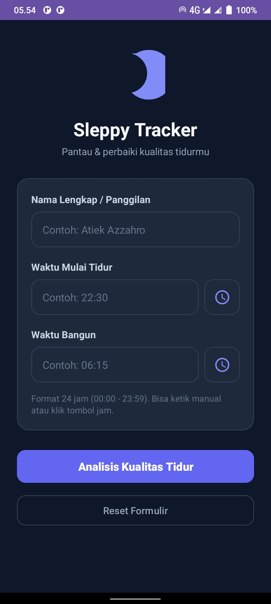
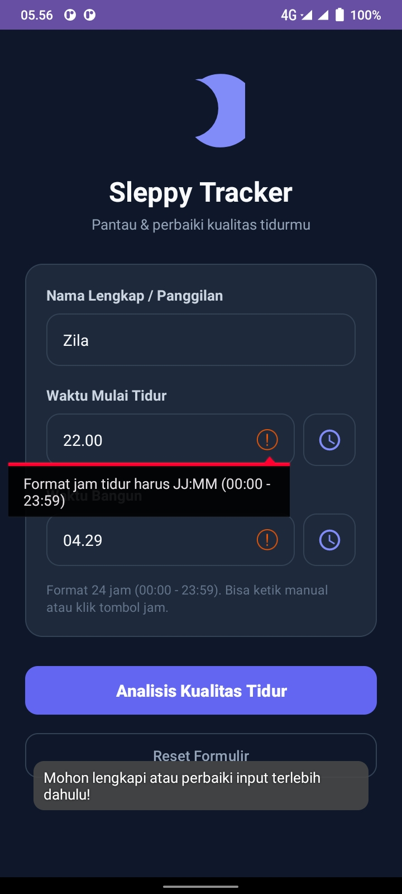
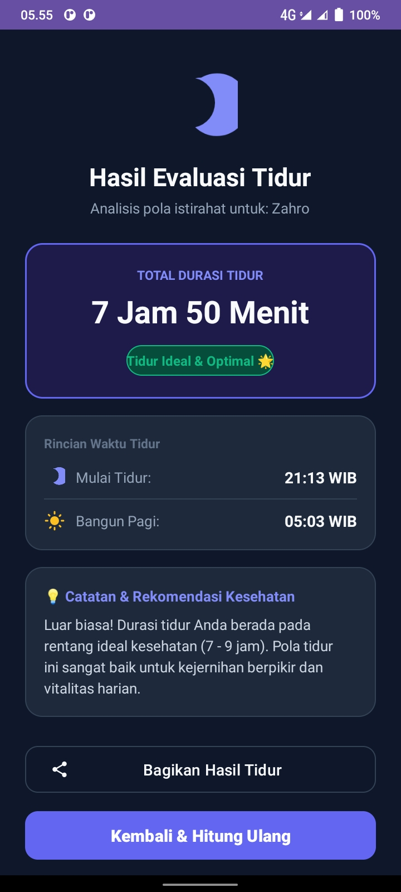

# 🌙 Sleppy Tracker 

Aplikasi pelacak waktu dan analisis kualitas tidur berbasis Android (Kotlin). Proyek ini merupakan pengembangan dari Tugas 1 dengan menambahkan **logika interaktif, validasi input multi-kondisi, pengolahan data durasi tidur, serta navigasi antar-layar menggunakan Intent eksplisit dan implisit**.

---

## 📱 Daftar Layar (Activities)

1. **MainActivity (Layar Beranda & Formulir Input)**
   - Formulir input nama pengguna, jam mulai tidur, dan jam bangun.
   - Fitur bantuan pemilih jam waktu nyata (`TimePickerDialog`) atau input teks manual format 24 jam (`JJ:MM`).
   - Validasi input dengan pesan error langsung (`setError`) dan fokus otomatis (`requestFocus`).
   - Tombol **Analisis Kualitas Tidur** untuk memproses data dan bernavigasi ke layar hasil.
   - Tombol **Reset Formulir** untuk mengosongkan seluruh isian form secara instan.

2. **SecondActivity (Layar Ringkasan & Hasil Evaluasi)**
   - Menampilkan salam personal kepada nama pengguna yang tersimpan.
   - Menampilkan sorotan utama **Total Durasi Tidur** (dalam Jam dan Menit).
   - Badge status tidur dinamis (*Tidur Ideal & Optimal*, *Cukup Baik*, *Kurang Tidur*, atau *Kelebihan Tidur*).
   - Kartu rincian jadwal jam mulai tidur dan jam bangun.
   - Kartu catatan evaluasi & rekomendasi medis terpersonalisasi.
   - Fitur **Bagikan Hasil Tidur** menggunakan *Implicit Intent* (`ACTION_SEND`).
   - Tombol **Kembali & Hitung Ulang** menggunakan `finish()`.

---

## 📸 Tangkapan Layar Aplikasi (Screenshots)

Berikut adalah dokumentasi antarmuka aplikasi Sleppy Tracker yang dijalankan pada perangkat HP / Emulator:

| 1. Layar Utama (Input & Formulir) | 2. Kasus Input Error (Validasi) | 3. Layar Hasil (Evaluasi Tidur) |
| :---: | :---: | :---: |
|  |  |  |

---

## 🎬 Video Demo Aplikasi (1–2 Menit)

> 🔗 **Tautan Video Demo:**  
> [▶️ Klik di Sini untuk Menonton Video Demo Aplikasi](https://drive.google.com/drive/folders/1aImAONWVU8nyTS4OlcwT12cy8YctJLKn)  

---

## 📖 Tutorial Menjalankan & Menggunakan Aplikasi

Aplikasi dapat dijalankan baik melalui **Emulator Android Studio** maupun langsung pada **HP Android Fisik**.

---

### Opsi A: Menjalankan di Emulator Android Studio

1. **Buka Proyek:**  
   Buka software **Android Studio**, lalu buka folder proyek `sleppy`. Tunggu proses *Gradle Sync* selesai.
2. **Siapkan Emulator (AVD):**  
   - Buka menu **Tools > Device Manager** di pojok kanan atas Android Studio.
   - Jika belum memiliki emulator, klik **Create Device**, pilih tipe (misal: *Pixel 7* atau *Pixel 8*), lalu pilih versi OS Android (disarankan API 26 hingga API 34+), kemudian klik **Finish**.
3. **Jalankan Aplikasi:**  
   - Pada dropdown pemilih perangkat di toolbar atas, pilih nama emulator yang telah dibuat.
   - Klik tombol **Run (▶)** berwarna hijau (atau tekan shortcut keyboard `Shift + F10`).
   - Emulator akan menyala dan aplikasi Sleppy Tracker akan terpasang serta terbuka secara otomatis.

---

### Opsi B: Menjalankan Langsung di HP Android Fisik

Menjalankan langsung di HP sangat disarankan untuk kemudahan merekam video demo dan tangkapan layar tugas:

1. **Aktifkan Opsi Pengembang (Developer Options) di HP:**
   - Buka **Pengaturan (Settings)** di ponsel Anda.
   - Masuk ke menu **Tentang Ponsel (About Phone)**.
   - Cari baris **Nomor Bentukan (Build Number)**, lalu ketuk sebanyak **7 kali secara beruntun** sampai muncul notifikasi: *"Anda sekarang adalah seorang pengembang!"*.
2. **Aktifkan Debugging USB (USB Debugging):**
   - Kembali ke halaman utama Pengaturan, masuk ke **Sistem > Opsi Pengembang (Developer Options)**.
   - Cari dan aktifkan opsi toggle **Debugging USB (USB Debugging)**.
3. **Hubungkan HP ke Komputer:**
   - Hubungkan HP ke laptop/PC menggunakan kabel data USB.
   - Pada layar HP Anda akan muncul pop-up izin: *"Izinkan debugging USB dari komputer ini?"*.
   - Centang opsi *"Selalu izinkan dari komputer ini"*, lalu ketuk **Izinkan (Allow)**.
4. **Instal & Jalankan dari Android Studio:**
   - Perhatikan toolbar bagian atas Android Studio, nama merek dan tipe HP Anda (misalnya: *Samsung SM-A525F* atau *Xiaomi Redmi*) akan otomatis terdeteksi di dropdown perangkat.
   - Klik tombol **Run (▶)** hijau (atau `Shift + F10`).
   - Aplikasi akan otomatis terinstal dan terbuka di layar HP Anda.

> 📱 **Tips Wireless Debugging (Tanpa Kabel):**  
> Jika HP Anda menggunakan Android 11+, Anda juga dapat menghubungkan HP tanpa kabel melalui menu **Device Manager > Pair Devices Using Wi-Fi** di Android Studio, lalu scan QR code melalui menu *Wireless Debugging* di HP Anda.

---

### 🕹️ Panduan Penggunaan Aplikasi (Alur Pengujian)

1. **Mengisi Data Pengguna:**
   - Masukkan nama Anda pada kolom **Nama Lengkap / Panggilan** (contoh: *Atiek Azzahro*).
2. **Menentukan Waktu Tidur & Bangun:**
   - Anda dapat mengetik manual dalam format 24 jam `JJ:MM` (contoh: `22:30` dan `06:15`).
   - Atau klik ikon **Jam ⏰** di sebelah kanan kolom untuk membuka jendela pemilih jam otomatis (*TimePickerDialog*), lalu pilih jam dan menit yang diinginkan.
3. **Melihat Kasus Error (Pengujian Validasi):**
   - Coba kosongkan salah satu kolom atau ketik format yang salah (misal: `25:99`), lalu tekan tombol **Analisis Kualitas Tidur**.
   - Sistem akan menolak dan menampilkan pesan error merah di bawah kolom terkait.
4. **Menganalisis & Melihat Hasil Olahan:**
   - Pastikan data telah terisi dengan benar, lalu klik tombol **Analisis Kualitas Tidur**.
   - Layar akan berpindah ke layar kedua (`SecondActivity`) yang menyajikan:
     - Total Durasi Tidur yang dihitung otomatis.
     - Status kecukupan tidur dengan badge warna dinamis.
     - Evaluasi serta saran medis personal.
5. **Membagikan Hasil:**
   - Klik tombol **Bagikan Hasil Tidur** untuk membuka lembar share Android (*chooser*) guna mengirimkan ringkasan teks ke WhatsApp, Catatan, atau media sosial.
6. **Kembali atau Ulangi:**
   - Klik tombol **Kembali & Hitung Ulang** untuk kembali ke halaman utama.
   - Klik tombol **Reset Formulir** jika ingin membersihkan seluruh isian form sekaligus.

---

## 🛠️ Ringkasan Spesifikasi Teknis Proyek

- **Bahasa Pemrograman:** Kotlin
- **Minimum SDK:** Android 7.0 (API Level 24)
- **Target / Compile SDK:** Android 14+ (API Level 34/37)
- **Komponen Utama UI:** ScrollView, LinearLayout, MaterialCard, EditText, Button, ImageButton, ImageView, TextView, TimePickerDialog
- **Mekanisme Navigasi:** Explicit Intent (`SecondActivity`) & Implicit Intent (`ACTION_SEND`)

